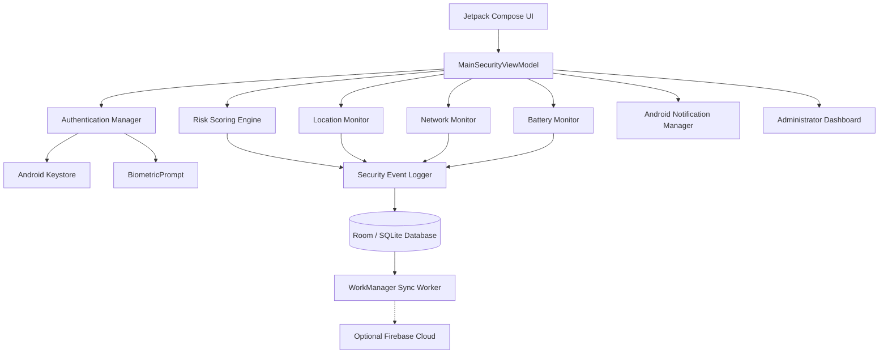

# 🔐 Smart Exam Paper Security and Mobile Monitoring System

### Smartphone-Based Mobile Security Sentinel

<p align="center">
  
  
  
  
</p>

<p align="center">
  <b>VELS Institute of Science, Technology & Advanced Studies (VISTAS)</b><br>
  Department of Computer Science & Engineering / Information Technology<br>
  Final-Year Engineering Capstone Project
</p>

---

## 📌 Project Overview

The Smart Exam Paper Security and Mobile Monitoring System is an Android-based security application designed to protect confidential examination materials during transportation and storage.

The original concept used an IoT-enabled physical security box with microcontrollers, GPS modules, solenoid locks, and GSM communication.

In this advanced implementation, the physical hardware is replaced by a **Smartphone-Based Mobile Security Sentinel** that provides authentication, location monitoring, security event detection, offline logging, and administrator alerts.

The application combines modern Android security technologies with a dedicated demonstration environment for academic evaluation.

### 🎯 Project Objectives

- Secure confidential examination materials through encrypted digital storage.
- Prevent unauthorized access using PIN and biometric authentication.
- Monitor device location and detect geofence violations.
- Detect suspicious activities and enforce temporary security lockouts.
- Maintain a persistent security audit trail, even without internet connectivity.
- Provide administrators with monitoring, alert management, and audit export capabilities.

> **Academic Integrity:** The application uses simulated examination packets and demonstration data. It does not contain or distribute real examination question papers.

---

## 🏗️ System Architecture



### 🔄 System Workflow

1. The user launches the application and completes authentication.
2. The security dashboard initializes location, connectivity, and battery monitoring.
3. The vault remains encrypted until authorized authentication succeeds.
4. The application evaluates security events and calculates the current risk score.
5. Suspicious activities trigger warnings, audit entries, and notifications.
6. Events are stored locally when offline and synchronized when connectivity returns.

---

## ✨ Key Features

### 🛡️ 1. Security Operations Dashboard

- Dynamic security status: PROTECTED, WARNING, or CRITICAL.
- Real-time security risk score from 0 to 100.
- GPS coordinates, location accuracy, and distance from the authorized center.
- Wi-Fi, cellular connectivity, and offline status.
- Battery level and charging state.
- Failed authentication attempts and pending synchronization count.

### 🔐 2. Secure Examination Vault

- AES-256-GCM encryption for protected digital examination data.
- Android Keystore integration for cryptographic key management.
- PIN-based authentication with salted SHA-256 verification.
- Biometric authentication using AndroidX BiometricPrompt.
- Simulated examination packet manifest and digital seal verification.
- SHA-256 integrity hashes for examination packet envelopes.

### 🚨 3. Unauthorized Access Detection

- Monitors invalid PIN and biometric authentication attempts.
- Enforces a three-attempt authentication limit.
- Activates a 60-second temporary lockout after three consecutive failures.
- Escalates the security status to CRITICAL.
- Records a SECURITY_LOCKOUT event and generates a notification.
- Resets the lockout after successful authentication or cooldown expiry.

### 📍 4. Real-Time Location Monitoring

- Uses Google Play Services Fused Location Provider.
- Supports configurable circular geofencing.
- Calculates distance using the Haversine formula.
- Generates a GEOFENCE_VIOLATION event when the device leaves the authorized perimeter.
- Provides a radar-style visualization of the device and geofence boundary.

**Default geofence configuration**

| Parameter | Value |
|---|---|
| Authorized Center | VELS Exam Center |
| Latitude | 12.9576° N |
| Longitude | 80.1444° E |
| Default Radius | 250 meters |
| Configurable Radius | 50–1000 meters |

### 📡 5. Network Monitoring and Offline Logging

- Monitors Wi-Fi and cellular network transitions.
- Detects network disconnection and restoration.
- Stores security events locally using Room / SQLite.
- Maintains a pending synchronization queue.
- Uses Android WorkManager to synchronize queued events when connectivity returns.

### 👨‍💼 6. Administrator Monitoring Dashboard

- Protected supervisory login portal.
- Registered device and supervisor overview.
- Security event monitoring and incident acknowledgement.
- Manual cloud synchronization trigger.
- Geofence configuration and radius adjustment.
- CSV audit trail export.
- Emergency audit database reset.

### 🧪 7. Demonstration Sandbox

The dedicated demonstration environment allows evaluators to test security responses without generating real-world incidents.

All simulated events are clearly identified as **DEMO DATA**.

| Simulation | Expected Result |
|---|---|
| Three failed PIN attempts | CRITICAL status and 60-second lockout |
| Geofence breach | Location violation and security alert |
| Geofence restoration | Device returns to authorized zone |
| Wi-Fi disconnection | Offline event buffering |
| Biometric unlock simulation | Demonstrates authorized vault access |
| Administrator acknowledgement | Active incidents marked as resolved |

---

## 📱 Application Screens

The application includes 13 Jetpack Compose screens.

| No. | Screen | Description |
|---|---|---|
| 01 | SplashScreen | Security initialization and diagnostics |
| 02 | LoginPinScreen | PIN authentication and lockout management |
| 03 | BiometricAuthScreen | Biometric authentication and fallback |
| 04 | DashboardScreen | Security status and device telemetry |
| 05 | ExamVaultScreen | Encrypted vault and examination manifest |
| 06 | LocationTrackingScreen | GPS telemetry and geofence visualization |
| 07 | SecurityEventLogScreen | Searchable audit trail and CSV export |
| 08 | AlertsNotificationScreen | Active and resolved security incidents |
| 09 | AdminDashboardScreen | Supervisory monitoring and demo controls |
| 10 | DeviceRegistrationScreen | Device enrollment and supervisor assignment |
| 11 | GeofenceConfigScreen | Geofence coordinates and radius configuration |
| 12 | SettingsPermissionsScreen | Permissions and security settings |
| 13 | AboutProjectScreen | Project information and system comparison |

---

## 🛠️ Technology Stack

| Component | Technology |
|---|---|
| Programming Language | Kotlin 2.x |
| User Interface | Jetpack Compose + Material 3 |
| Architecture | MVVM + StateFlow |
| Local Database | SQLite / Room |
| Cryptography | Android Keystore + AES-256-GCM |
| PIN Verification | Salted SHA-256 |
| Biometrics | AndroidX BiometricPrompt |
| Location | Fused Location Provider |
| Connectivity | Android ConnectivityManager |
| Background Processing | Android WorkManager |
| Notifications | Android NotificationManager |
| Cloud Integration | Optional Firebase Cloud Firestore |
| Audit Export | RFC-4180 compliant CSV |

---

## 📋 Prerequisites

Before building the project, ensure the following are installed:

- Android Studio Ladybug, Koala, or Hedgehog, or a compatible newer version.
- JDK 17.
- Android SDK Platform 35 or 36.
- Android Build Tools 35.0.0 or 36.0.0.
- Android device or emulator running Android 8.0 (API 26) or later.

---

## 🚀 Installation and Build

### 1. Clone the Repository

```bash
git clone https://github.com/suryx12-a/SmartExamSecurity.git
cd SmartExamSecurity
```

Replace the repository URL with your actual GitHub repository URL if the project is hosted elsewhere.

### 2. Configure Java

In Windows PowerShell:

```powershell
$env:JAVA_HOME = "C:\Users\suryx\AppData\Local\jdk-17\jdk-17.0.12+7"
```

### 3. Run Unit Tests

```powershell
.\gradlew.bat testDebugUnitTest
```

### 4. Build the Debug APK

```powershell
.\gradlew.bat assembleDebug
```

### 5. Install the Application

```powershell
adb install -r app\build\outputs\apk\debug\app-debug.apk
```

The generated APK can be found at:

```text
app/build/outputs/apk/debug/app-debug.apk
```

---

## 🧪 Automated Testing

The project includes unit tests covering the core security logic.

| Test Class | Test Coverage | Status |
|---|---|---|
| AuthenticationLogicTest | PIN validation, lockout, cooldown | PASSED |
| RiskScoringEngineTest | Risk calculation and status mapping | PASSED |
| GeofenceCalculatorTest | Haversine distance and geofence boundaries | PASSED |
| SecurityEventLoggingTest | Event IDs, timestamps, severity, demo flags | PASSED |

**Reported test result:** All listed unit tests passed with zero failures.

---

## 🎓 College Viva Demonstration

The following sequence demonstrates the primary security features.

1. **Launch and Diagnostics:** Show the splash screen and initialization checks.
2. **Authentication:** Enter the demonstration PIN `123456` or use the college demo bypass.
3. **Security Dashboard:** Explain the risk score, location telemetry, and security status.
4. **Examination Vault:** Demonstrate the sealed vault and simulated examination packet manifest.
5. **Authentication Lockout:** Trigger three failed PIN attempts and show the CRITICAL status and countdown.
6. **Geofence Violation:** Simulate a location breach and show the resulting alert.
7. **Offline Buffering:** Simulate Wi-Fi disconnection and demonstrate local event storage.
8. **Audit Export:** Acknowledge active incidents and export the security event log to CSV.

> **Demonstration Notice:** Simulation controls are intended for academic evaluation. Simulated location changes and authentication events are not evidence of actual physical movement or unauthorized access.

---

## ☁️ Optional Firebase Integration

The application supports local demonstration mode without Firebase credentials.

To enable cloud monitoring:

1. Create a Firebase project.
2. Register the Android application using the package name `com.smartexambox.security`.
3. Download `google-services.json` and place it inside the `app/` directory.
4. Configure the Google Services Gradle plugin.
5. Configure Firebase Authentication and Cloud Firestore.
6. Apply restrictive Firestore security rules.

**Security recommendation:** Do not use public read/write access for examination security records. Restrict access to authenticated and authorized administrators, and validate device authorization on the backend.

---

## 🔒 Security Considerations

- Never store plaintext PINs or passwords.
- Use Android Keystore to protect cryptographic keys.
- Treat demo authentication and simulated security events as non-production functionality.
- Enforce authorization on the server side for cloud operations.
- Protect sensitive audit records from unauthorized modification.
- Request location and notification permissions only when required.
- Do not collect or transmit real examination papers during demonstration.

---

## 📈 Future Enhancements

- Hardware-backed device attestation.
- Production-grade administrator authentication and role-based access control.
- Tamper-evident audit records using cryptographic hash chaining.
- Secure cloud synchronization with backend authorization.
- Multi-device monitoring and centralized incident management.
- Integration with institutional examination management systems.

---

## 👨‍🎓 Project Information

**Project Title:** Smart Exam Paper Security and Mobile Monitoring System

**Institution:** VELS Institute of Science, Technology & Advanced Studies (VISTAS)

**Department:** Computer Science & Engineering / Information Technology

**Project Type:** Final-Year Engineering Capstone Project

**Developed for:** Academic demonstration and evaluation

---

<p align="center">
  <b>Securing Examination Integrity Through Mobile Technology</b><br>
  <sub>All intellectual property and code belong to the engineering candidate.</sub>
</p>
