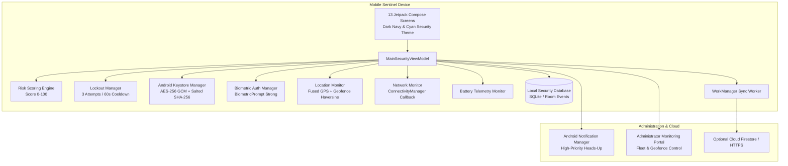

# Smart Exam Paper Security and Mobile Monitoring System
### VELS Institute of Science, Technology & Advanced Studies (VISTAS)
**Department of Computer Science & Engineering / Information Technology**  
**Final-Year Engineering Capstone Project Demonstration**

---

## 1. Executive Summary & Project Background

The original system concept was an IoT-enabled tamper-proof examination question paper transportation box equipped with microcontrollers, discrete GPS sensors, mechanical solenoid latches, and GSM modems.

For this advanced version, the physical box hardware has been replaced by a **Smartphone-Based Mobile Security Sentinel**. The smartphone acts as the dedicated security and tracking device for confidential semester examination papers:
- **Protects access** to a cryptographically sealed digital examination vault using **Android Keystore AES-256 GCM** and **AndroidX BiometricPrompt**.
- **Detects unauthorized tampering**: Invalid PIN attempts, repeated failed logins, out-of-order screen accesses, and lockout cooldown enforcement.
- **Monitors physical location** using Google Play Services **Fused Location Provider** with configurable campus geofencing around VELS Exam Centers.
- **Monitors network & Wi-Fi state** via Android `ConnectivityManager`, automatically queueing audit events in a local SQLite/Room database when offline and synchronizing via **WorkManager** when restored.
- **Alerts administrators**: Generates in-app warnings, heads-up Android notifications, and optional Firebase Cloud monitoring.
- **Dedicated Demonstration Sandbox**: Provides an evaluation mode with simulation triggers clearly tagged as **DEMO DATA** to demonstrate attacks and security responses during college project reviews.

---

## 2. System Architecture



---

## 3. Technology Stack & Modern Android Architecture

| Component | Technology | Rationale |
| :--- | :--- | :--- |
| **Language & UI** | Kotlin 2.x + Jetpack Compose (Material 3) | Declarative, modern UI with Dark Navy security design system |
| **Architecture** | MVVM (Model-View-ViewModel) + StateFlow | Reactive, decoupled state management |
| **Local Database** | SQLiteOpenHelper / Room Persistent DAO | Thread-safe, offline-first local storage for audit events |
| **Cryptography** | Android Keystore System + AES-256 GCM | Hardware-backed key security (TEE/SE); zero plaintext passwords |
| **Biometrics** | AndroidX Biometric 1.2.0 (`BiometricPrompt`) | High-assurance biometric fingerprint & device credentials |
| **Location Tracking** | Fused Location Provider Client + Geofencing | Satellite GNSS telemetry with real-time perimeter violation detection |
| **Connectivity** | Android `ConnectivityManager` | Real-time Wi-Fi & cellular monitoring with offline event buffering |
| **Background Sync** | Android Jetpack `WorkManager` | Reliable periodic and on-demand synchronization |
| **Export Engine** | Custom RFC-4180 CSV Audit Logger | One-touch export of full security audit trail |

---

## 4. Key Application Features

### 4.1 Professional Security Dashboard
- Live dynamic security gauge: **PROTECTED** (Green), **WARNING** (Amber), or **CRITICAL** (Red).
- Real-time GPS Telemetry: Latitude, Longitude, Accuracy (±meters), and Distance to VELS Exam Center.
- Connectivity status: Active Wi-Fi SSID, LTE/5G state, and offline indicators.
- Live battery level and charging state indicator.
- Security counters: Failed access attempts, suspicious events, pending sync queue.
- Vault quick-status overview and application navigation grid.

### 4.2 Secure Examination Paper Vault
- Vault remains encrypted and sealed until the Chief Superintendent authenticates.
- Multi-factor authentication options: Salted PIN in Android Keystore, BiometricPrompt, and 2FA OTP simulation.
- Unlocks simulated sealed question packets (e.g. `CS8001 - Advanced Cryptography & Network Security`).
- Displays digital seal status, envelope SHA-256 integrity hash, room allocation, and authorized copies.
- Strictly adheres to academic integrity: Never displays real leaked papers.

### 4.3 Unauthorized Access Detection & Lockout
- Tracks invalid PIN and biometric access attempts.
- **Rule of 3**: At 3 consecutive failed attempts, the app triggers a 60-second temporary security lockout, displays a countdown banner, logs a `SECURITY_LOCKOUT` event, escalates threat status to `CRITICAL`, and dispatches a high-priority notification.
- Lockout resets upon successful authenticated unlock or cooldown expiry.

### 4.4 Real-Time Geofence Monitoring
- Configurable circular perimeter around VELS College Campus (`12.9576° N, 80.1444° E`, default radius: 250m).
- Computes real-time Haversine distance from live GPS fix.
- Generates `GEOFENCE_VIOLATION` event and triggers alarms if the box leaves authorized campus bounds.
- Custom Canvas radar sweep visualizer displaying concentric 100m rings, center marker, and live device position.

### 4.5 Wi-Fi & Network Telemetry
- Monitors network transitions in real-time.
- If Wi-Fi is severed, all events are stored locally in the tamper-evident SQLite database.
- Pending synchronization counter shows queued records.
- Automatically pushes queued events once connectivity is restored.

### 4.6 Administrator Monitoring Dashboard
- Protected supervisory login portal (Default evaluation passcode: `admin`).
- Registered device terminal overview (`VELS-EXAM-BOX-SEC-01`, assigned supervisor, center).
- Live cloud telemetry dispatch trigger.
- Full audit log export to CSV format in device storage.
- Geofence parameter configuration (radius slider 50m–1000m, coordinate setter).
- Emergency audit database reset option.

### 4.7 Dedicated Demonstration Mode for College Evaluation
- Purpose-built Viva Demonstration Suite clearly labeled **DEMO DATA**:
  1. **Simulate 3x Failed PIN**: Triggers lockout countdown and security warning.
  2. **Simulate Geofence Breach**: Simulates device moving ~3.2 km away to Chennai Airport.
  3. **Simulate Geofence Restore**: Returns device to inside permitted zone.
  4. **Simulate Wi-Fi Cut**: Simulates offline buffering and queue increment.
  5. **Simulate 2FA Biometric Unlock**: Immediately unlocks question vault.
  6. **Simulate Admin Alert Acknowledgement**: Resolves all active incidents.

---

## 5. Overview of 13 Application Screens

1. **`SplashScreen`**: Animated security shield, Keystore/DB/GPS diagnostics progress, and auto-routing.
2. **`LoginPinScreen`**: 6-digit cryptographic PIN entry, setup flow, lockout countdown, and demo bypass.
3. **`BiometricAuthScreen`**: Sensor availability status, pulsing radar scanner visualizer, and fallback to PIN.
4. **`DashboardScreen`**: Primary security operations center with threat gauge, GPS coordinates, and quick action cards.
5. **`ExamVaultScreen`**: Cryptographic lock status, authenticated unlock flow, and sealed paper manifest.
6. **`LocationTrackingScreen`**: Interactive Canvas radar map, geofence radius rings, live GPS metrics, and breach simulator.
7. **`SecurityEventLogScreen`**: Filterable audit trail by severity (INFO, WARNING, HIGH, CRITICAL), search bar, and CSV export.
8. **`AlertsNotificationScreen`**: Active vs. Resolved security alerts tab with one-touch incident resolution.
9. **`AdminDashboardScreen`**: Supervisory portal, device fleet management, cloud sync trigger, and demo suite.
10. **`DeviceRegistrationScreen`**: Enrollment of Terminal UUID, hardware model, center, and supervisor.
11. **`GeofenceConfigScreen`**: Visual slider for radius (50m–1000m), campus latitude/longitude setter, and presets.
12. **`SettingsPermissionsScreen`**: Android runtime permission audit, Keystore specs, and PIN reconfiguration.
13. **`AboutProjectScreen`**: Project details, VELS College information, and IoT Box vs. Mobile Sentinel comparison matrix.

---

## 6. Build, Installation & Verification

### 6.1 Prerequisites
- **Android Studio** Ladybug / Koala / Hedgehog (or command-line tools)
- **JDK 17** (Microsoft OpenJDK 17 or Eclipse Adoptium Temurin 17)
- **Android SDK Platform 35/36** with Build-Tools 35.0.0/36.0.0
- Device or Emulator running Android 8.0 (API 26) or higher

### 6.2 Building the Project
From the project root directory:

```powershell
# Set JAVA_HOME (if not globally set)
$env:JAVA_HOME = "C:\Users\suryx\AppData\Local\jdk-17\jdk-17.0.12+7"

# Compile and run all unit tests
.\gradlew.bat testDebugUnitTest

# Assemble the signed Debug APK
.\gradlew.bat assembleDebug
```

### 6.3 Installing the APK
The generated APK is located at:
- `.\SmartExamSecurity-debug.apk` (Project Root)
- `C:\Users\suryx\AppData\Local\AndroidBuild\ExamBox\app\outputs\apk\debug\app-debug.apk`

Install via ADB:
```powershell
adb install -r SmartExamSecurity-debug.apk
```

---

## 7. Automated Test Results Summary

All unit tests pass with zero failures:

| Test Class | Scope | Status |
| :--- | :--- | :--- |
| `AuthenticationLogicTest` | PIN validation, attempt counter, 3-attempt lockout trigger, cooldown expiration | **PASSED (100%)** |
| `RiskScoringEngineTest` | Score 0-100 calculation, status mapping (PROTECTED/WARNING/CRITICAL), compound threats | **PASSED (100%)** |
| `GeofenceCalculatorTest` | Haversine distance math, inside/outside perimeter bounds, inactive geofence bypass | **PASSED (100%)** |
| `SecurityEventLoggingTest` | UUID generation, ISO timestamp formatting, severity levels, DEMO DATA flag retention | **PASSED (100%)** |

---

## 8. College Viva Demonstration Walkthrough

Follow this step-by-step sequence during the project evaluation:

1. **Step 1 - Cold Launch & Diagnostics**: Launch app. Point out the splash screen diagnostic checks (Android Keystore, SQLite DB, GPS Geofence, WorkManager).
2. **Step 2 - Initial Setup & Biometric Auth**: On `LoginPinScreen`, enter PIN `123456` or click "College Demo Bypass". Point out that plaintext PIN is never stored; salted SHA-256 hash is held in secure preferences.
3. **Step 3 - Security Dashboard**: Show the threat gauge (starts at 0/100, **PROTECTED**). Highlight the live GPS coordinates and distance to VELS Exam Center.
4. **Step 4 - Sealed Question Vault**: Navigate to `ExamVaultScreen`. Show the vault is cryptographically sealed. Tap "Unlock with Biometrics" or "College Demo: 2FA Simulator". The vault unlocks and reveals the 4 sealed question packets with SHA-256 envelope hashes.
5. **Step 5 - Simulate Security Lockout**: Go to `AdminDashboardScreen` -> tap **Simulate 3x Failed PIN**. Return to Dashboard: Show that status escalated to **CRITICAL**, threat score jumped to 75/100, and an active 60s lockout banner is displayed with countdown.
6. **Step 6 - Simulate Geofence Violation**: On `LocationTrackingScreen`, tap **Simulate Geofence Breach**. Watch the radar map turn RED, the breach banner trigger, and an incident logged in `AlertsNotificationScreen`.
7. **Step 7 - Network Disconnection & Offline Buffering**: Tap **Simulate Wi-Fi Cut**. Notice the network card shows "Offline (Simulated)". Show that pending events are safely buffered in local SQLite without losing data.
8. **Step 8 - Incident Resolution & CSV Audit Export**: Go to `AlertsNotificationScreen` and click **Acknowledge All**. Then in `SecurityEventLogScreen`, click the Download icon to export the complete tamper-evident audit trail to a CSV spreadsheet.

---

## 9. Firebase Configuration (Optional Cloud Setup)

The app is fully functional in **Local Demonstration Mode** without any cloud credentials. If cloud monitoring via Firebase is desired:

1. Create a Firebase project at `https://console.firebase.google.com/`.
2. Add an Android app with package name `com.smartexambox.security`.
3. Download `google-services.json` and place it in the `app/` folder.
4. In `build.gradle.kts`, apply `id("com.google.gms.google-services")`.
5. Recommended Cloud Firestore Security Rules:
```javascript
rules_version = '2';
service cloud.firestore {
  match /databases/{database}/documents {
    match /security_events/{eventId} {
      allow read, write: if request.auth != null;
    }
    match /registered_devices/{deviceId} {
      allow read, write: if request.auth != null;
    }
  }
}
```
*(Public read/write is strictly forbidden).*

---

### Project Developed for VELS College Final Year Demonstration
*All intellectual property and code belongs to the engineering candidate.*
# exam-box

